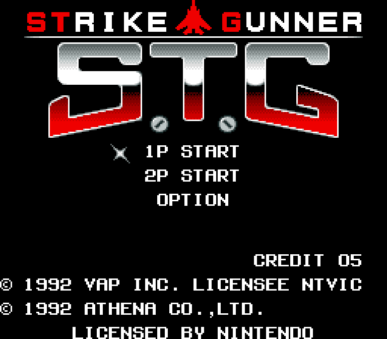
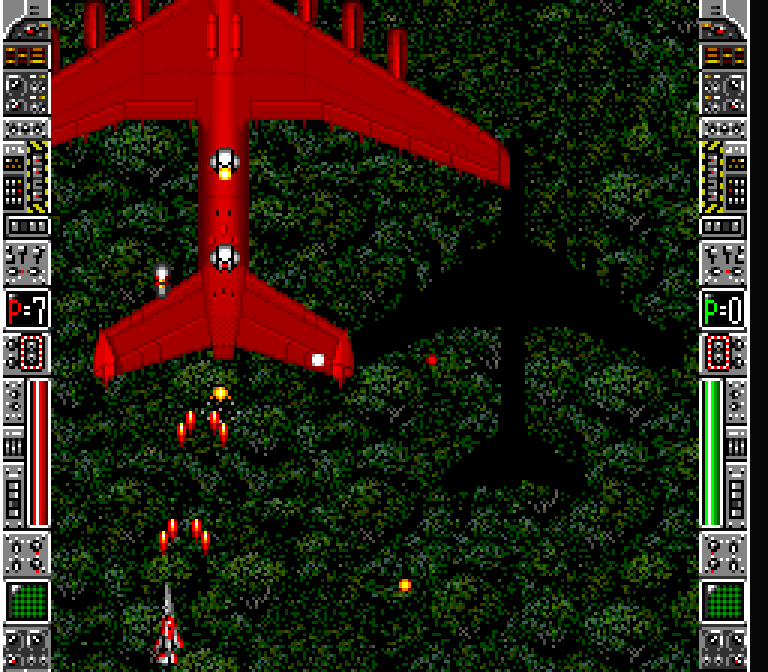
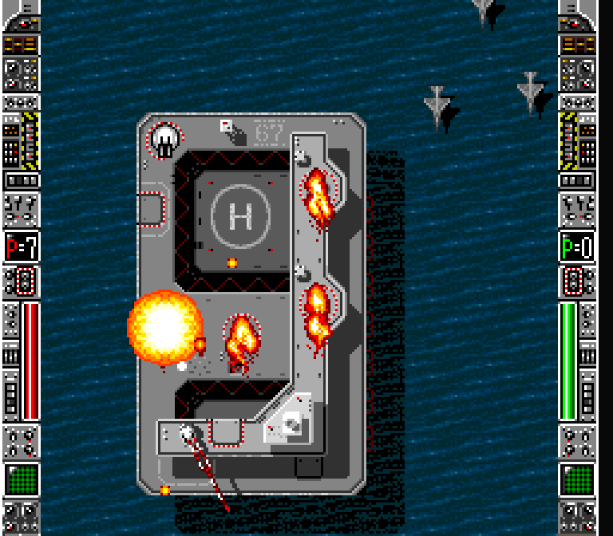
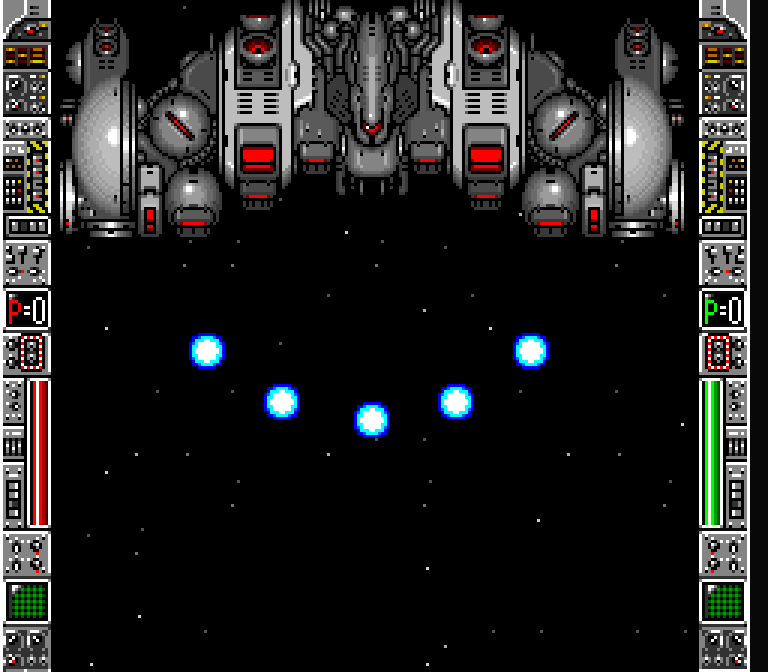
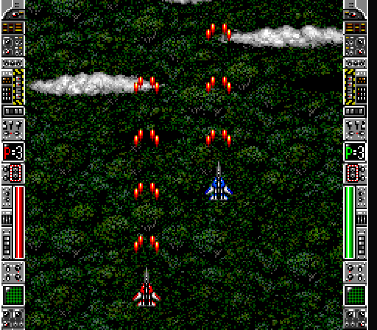

# Strike Gunner S.T.G Recomp



A native recompilation of **Strike Gunner S.T.G** (USA), built on
[snesrecomp](https://github.com/RetroPortingToolKit/snesrecomp).

A vertical shoot-'em-up from 1992, recompiled from the 65816 to native code:
the game's own logic runs as compiled C against an emulated SNES video chip,
sound chip and DMA, with the framework's interpreter as a fallback for code no
analysis has reached.


> **You must legally own a copy of the game.** No ROM data is distributed with
> this project, in the repository or in any release. The recompiled C is
> generated locally from your own copy and is never committed.

**Just want to play?** Download the latest release from the
[Releases page](https://github.com/SlippyGetBackHere/Strike-Gunner-STG-Recomp/releases)
and see [`PLAYING.md`](PLAYING.md): setup, controls, options and how to report
a problem. The rest of this file is for building and developing the port.

## Screenshots

| | |
|:---:|:---:|
|  |  |
| Weapon select: 15 weapons to choose from | Stage 2: a bomber squadron |
|  |  |
| Stage 4: the fleet at sea | Stage 4: attacking a warship |
|  |  |
| Stage 6: the mothership in the asteroid field | Two players at once (2P START) |

## Status

**Playable from start to finish** (as of 2026-10-14): intro, attract demo,
all stages, and the ending through the credits to "The End", in single-player
play on Windows. Two-player play starts and both ships answer their own
controller (headless check), and the launcher's second seat works with
either player on keyboard or pad; a full 2P playthrough has not been done.

- **Accuracy.** Checked against snes9x with identical scripted input: game
  events land on the same frames for the first 3,162 frames of a
  13,500-frame route, in both compiled and interpreted execution, and stage
  4's heaviest section slows down exactly as much as on the reference
  (3,536 of 3,600 frames on time).
- **Graphics.** Correct throughout play, including save states loaded while
  paused.
- **Audio.** Matches the reference. The remaining occasional pops are in the
  game's own sound (see [Options](#options)).
- **Native code.** 982 compiled variants, seeded from coverage captures of
  the intro, attract demo, stage 1, one full playthrough and the ending
  (`recomp/coverage/`). Uncovered code runs on the interpreter.
- **Save states** keep the frame driver's resume point, so a state resumes
  exactly where it was made (checked by saving, playing on, and reloading:
  identical memory and picture).
- **Rewind** (0.1.1): quarter-second steps, 25 seconds back by default,
  adjustable in the launcher. Committing a rewind lands exactly on the
  earlier frame (2 seconds back matched a plain run 120 frames earlier:
  memory, video memory, registers and picture), and committing, cancelling
  and opening work from keyboard and controller (checked by hand). Opening
  the save-state browser or rewind panel without committing leaves the game
  bit-identical.
- **Setup packs.** `scripts/package_release.sh` builds a setup pack that
  generates and builds the game on the player's PC from their ROM, with no
  Rust or other tools beyond what the launcher downloads. Checked on
  Windows from a fresh unzip: the code it generates matches a developer
  regeneration, and the game played through stage 1. Current release:
  0.1.2 (tag `v0.1.2`). The framework's documentation and test suites are
  left out of packs.
- **Mods**: features on the launcher's Mods page, all off by default
  (`mods/preloaded/packages/strikegunnerstg.gameplay`). Off, the game is
  unchanged (attract run identical to the stock build).
  - *Infinite lives* (0.1.2, `src/mod_infinite_lives.c`): neither player
    loses spare lives.
  - *All weapons every stage* (`src/mod_all_weapons.c`): the used-weapon
    flags ($1BED / $1BFC, one byte per weapon) are cleared every frame, so
    the weapon select screen never marks a weapon NO USE.

Open items and what has been ruled out are in [`KNOWN_ISSUES.md`](KNOWN_ISSUES.md).

## ROM identity

| | |
|---|---|
| File | `Strike Gunner S.T.G (USA).sfc` |
| Publisher | VAP (US licensee NTVIC) |
| Developer | Athena |
| Year | 1992 |
| Mapping | lorom |
| Region | USA (North America) |
| Coprocessor | none |
| CRC32 | `d054e288` |
| SHA-256 | `05f14e6ed3394d9273e2397769a8acf1a9db646be6066e82269521e8eec53562` |

`tools/regen.sh` refuses to run against anything else, so a mismatched
revision fails immediately instead of producing subtly wrong output.

## Build

On Windows, configure with Ninja and clang (the retcomm `cmake-clang-v1`
toolchain): the default Visual Studio generator uses MSVC, which cannot
compile the framework. The analyzer needs Rust (`cargo`) the first time.

```sh
git submodule update --init --recursive
bash tools/regen.sh --rom "/path/to/Strike Gunner S.T.G (USA).sfc"
cmake -S . -B build -G Ninja -DCMAKE_BUILD_TYPE=Release -DCMAKE_C_COMPILER=clang -DCMAKE_CXX_COMPILER=clang++
cmake --build build -j
```

The `snesrecomp` submodule comes from a fork,
[SlippyGetBackHere/snesrecomp](https://github.com/SlippyGetBackHere/snesrecomp),
branch `local/mode2-renderer-fix`: upstream plus thirteen changes this port needs
that are not upstream. `git clone --recursive` fetches it.
`patches/README.md` lists the fixes and how to re-apply them to upstream.

The ROM does not have to live in the repository — keeping it on your own
drive is the better habit, and `SNESRECOMP_ROM` sets the path once for a
shell. Without either, `tools/regen.sh` finds `Strike Gunner S.T.G (USA).sfc` at the repo root,
then the path the setup wizard recorded in `rom.cfg`; `.gitignore` blocks
both from ever being committed.

`tools/regen.sh` verifies the ROM, generates `src/gen/*.c`, and re-syncs
`recomp/funcs.h`. Re-run it whenever you change anything under `recomp/`.

## Run

```sh
./build/StrikeGunnerSTGSNESRecomp                     # launcher picks the ROM
./build/StrikeGunnerSTGSNESRecomp "/path/to/Strike Gunner S.T.G (USA).sfc" # or name it and skip the launcher
```

With no ROM on the command line the build opens the recomp-ui launcher: a ROM
picker with a verification badge, plus display / audio / input settings. Your
choice is cached in `rom.cfg` beside the executable, so the next launch opens
on it and "Skip launcher on boot" makes it immediate. If the launcher is not
built in (`--no-recomp-ui`), the host falls back to a native file picker.

Either way the ROM is checked against the digests above before anything boots
— a dump that could not have produced this build is refused at the door rather
than mis-executing ten frames in.

## Options

`strikegunner.ini` beside the executable (created on first launch):

| Key | Values |
|---|---|
| `ReduceSlowdown` | `0` authentic console speed (default); `1`, `2`, `3` run the SNES CPU 2x, 3x, 4x faster |
| `AudioDeclick` | `1` (default) caps sound samples that overflow instead of wrapping them, removing the loudest pops; `0` is the console's exact output |

The game slows down where its logic needs more than a frame; at `1` the
heaviest scene measured (stage 4, ocean section, extra fighters out) holds
60 fps. Frames that already fit are unchanged, so game speed and music stay
authentic. Restart to apply. Some pops remain with `AudioDeclick` on: they are
in the original game's sound (snes9x and footage of the console have them
too). It is a separate file because the host rewrites `config.ini` from the
settings it knows.

## Layout

| Path | What lives there |
|---|---|
| `recomp/` | Analysis input: `bank*.cfg`, `symbols.toml`, generated `funcs.h` |
| `recomp/coverage/` | Coverage captures that seed the analyzer (addresses and hit counts, no ROM data) |
| `rom_identity.txt` | ROM digests — read by the build, `tools/regen.sh` and CI |
| `src/` | Host code: `main.c`, `game_rtl.c` (frame driver, save-state hooks, options), `gen_stubs.c` (frame-wait and task-switch hand-backs) |
| `src/gen/` | Generated C. Never committed — regenerate locally |
| `snesrecomp/` | Framework submodule (owns `lib/recomp-net`, `lib/retcomm-rbengine`) |
| `tools/` | `regen.sh` — the ROM → C pipeline |
| `scripts/` | `package_release.sh` — player-facing zip |
| `patches/` | The local framework fixes, one patch per commit, with notes |
| `framework_pins.txt` | Exact framework commits this project is pinned to |
| `KNOWN_ISSUES.md` | Open issues, resolved ones, and what was ruled out |

## How the port works

- **Frame driver** (`src/game_rtl.c`). The framework's beam-aligned driver
  with one change: NMI is taken the way the CPU takes it, so the game's
  NMI handler -- which switches NMI off and runs for several frames during
  scene changes -- can span fields.
- **Frame waits and task switches** (`recomp/bank00.cfg`, `bank05.cfg`,
  `src/gen_stubs.c`). Compiled code cannot wait for the next frame, so the
  game's four wait routines and its cooperative task scheduler ($8D2E /
  $8D68) are declared `hle_func` and handed back to the driver's
  interpreter, which runs the original bytes.
- **Object handlers** (`recomp/symbols.toml`, `bank03.cfg`). All 165 entries
  of the object table at $03:8000 and the object loop are compiled, so
  enemies from every stage are native code.

## Continuing

- **Coverage.** Play with `--coverage-capture=on`, add the capture from
  `%LOCALAPPDATA%\snesrecomp-coverage\strikegunnerstg\` to
  `recomp/coverage/`, re-run `tools/regen.sh`, rebuild, and check the
  result plays the same. A new frame wait reached only from compiled code
  shows up as a hitch or freeze with an `[interp_cap]` line in the log;
  declare it like the others.
- **Diagnostics.** `STG_AUDIOLOG=<file>` logs the audio pipeline once a
  second. The framework's `tools/snesref` with a libretro SNES core is the
  reference for timing and audio comparisons.
- **Never edit `src/gen/`** or synthesise a result to get past uncovered
  code. Fix the config or the framework and regenerate.

## Multiplayer

Two players at once on one PC: **2P START** on the title screen, one
controller each (or rebind `[player2]` in `keybinds.ini`). Netplay is not
built into this target.

## License

This project's own source is under the license in `LICENSE`. The framework
carries its own terms — see `snesrecomp/LICENSE` and
`snesrecomp/THIRD_PARTY_ATTRIBUTION.md`. Neither covers the game data, which
is not distributed here.
